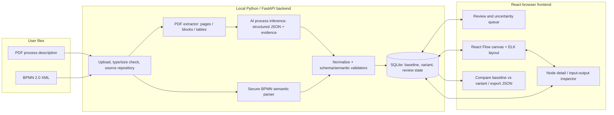

# ProcessFlow — initial product definition, architecture and verification baseline

**Status:** proposed concept / requirements baseline v0.1 — 12 November 2026  
**Source:** supplied 13-page Gemini conversation extract, preserved under `source/`.  
**Audience:** project sponsor, developer (Claude AI), process owner, reviewer and tester.  
**Important:** The requirements and numerical targets below are *proposals*, not approved corporate requirements or claims about existing software. The supplied conversation contains no real process PDF/XML test files or user-approved performance/security thresholds. Validate this baseline with actual documents.

## 1. Executive decision summary

**Goal.** Build a local-first, browser-based tool which imports (A) process descriptions in PDF and (B) BPMN 2.0 XML process models, converts both to a consistent **ProcessGraph**, and shows an interactive, modern flow diagram. Selecting a step opens an inspector to **add, modify or tailor out inputs/outputs**. Users can review the inferred flow, see its provenance, preserve the imported baseline, and save editable variants.

**Proposed implementation.** FastAPI + Python/Pydantic + PyMuPDF + secure namespace-aware BPMN XML parser on the backend; React + TypeScript + `@xyflow/react` and ELK.js layout on the frontend; SQLite and on-disk local project artifacts initially. A provider-agnostic AI extraction adapter is *optional but required for automatic interpretation of narrative PDFs*. Its absence must produce an honest unconfigured/manual-review state, not simulated extraction.

**Priority.** First prove XML-to-graph deterministically and the interactive editor end-to-end; then add text-based PDF extraction with an evidence-linked human review gate. This sequence reduces uncertainty without treating PDF as out of scope. Both pipelines are MVP deliverables.

**Out of scope for v0.1.** Executing workflows; changing the source PDF/XML; round-trip semantic BPMN 2.0 authoring/export; full BPMN execution semantics, all vendor extensions; collaboration, identity/SSO, cloud deployment, OCR of scanned PDFs, and automatic approval or compliance certification. Those may be future releases.

**Why not simply use a BPMN renderer?** Standard bpmn-js is well suited to faithfully displaying native BPMN XML but user specified a modern interactive flowchart, not formal BPMN editing. `@xyflow/react` is the primary renderer; bpmn-js can later be an optional read-only source view. The canonical graph preserves the important BPMN semantics rather than equating every gateway or connection.

## 2. Trace to the supplied conversation — established vs proposed

| Topic | User-established in Gemini extract | This proposal adds / clarifies |
|---|---|---|
| Sources | PDFs describing actions, inputs, outputs, branches, dependencies; BPMN XML exports | Explicit scope/limitations, provenance, validation, trusted/untrusted distinction |
| Platform | Python, browser-accessible web application | FastAPI + React/TypeScript + local-first packaging |
| Presentation | Modern interactive flowchart canvas, not strict BPMN notation | Two UI layout alternatives, modes, inspections, review markings |
| Editing | Select steps; add/remove (tailor out)/customize inputs and outputs | Non-destructive variants, explicit exclusions, save/reload, change history |
| Core architecture | Two ingestion pipelines, shared JSON graph | Typed schema, stable IDs, source locations, diagnostics and preservation of unhandled BPMN constructs |
| BPMN interpretation | XML structural mapping | Correct namespace, pools/lanes, typed edges, missing-DI handling, guarded parsing |
| PDF interpretation | Text extraction + LLM | Structured evidence, uncertainty labels, review before authoritative use |

### Specific corrections to the Gemini response

1. The example namespace `{'bpmn': 'http://omg.org'}` is **incorrect**. Use `http://www.omg.org/spec/BPMN/20100524/MODEL`; discover elements by qualified namespace/local names, not XML prefix spelling.
2. Its example parser extracts only some tasks, gateways and sequence flows; a meaningful viewer must handle start/end/intermediate events, other gateways, lanes/pools, subprocesses and message flows, and must **flag unsupported** elements rather than discard them silently.
3. A modern flowchart **need not** recreate the original `bpmndi` coordinates, but it must preserve semantic meaning. If DI exists it can optionally inform the initial layout; if absent the application must auto-layout.
4. PDF text extraction can misread multi-column documents and tables; LLM output is not proof. Each inferred step/edge needs source evidence or an explicit `unverified` state and review.
5. User editing must distinguish data inputs/outputs from *sequence edges*, and tailoring from destructive deletion. Changes belong to a versioned user variant.
6. The example `/api/save-process` returns success without persisting anything; the implementation must demonstrate real persistence and reload tests.
7. An XML parser must reject DTD/entity attacks and enforce resource limits; the naive `etree.fromstring(xml_content)` sample is not an adequate security design.

## 3. Stakeholders and needs

| ID | Stakeholder | Need / rationale | Proposed verification |
|---|---|---|---|
| N-01 | Process reader | Understand sequence, branches and responsibility from a dense PDF without manually drawing each step | Demonstration with an annotated text-based PDF; independent review of result |
| N-02 | Process reader | View BPMN 2.0 XML exports without needing the authoring application | Demonstration with XML fixtures, with and without BPMNDI |
| N-03 | Process analyst | Explore/zoom/search a modern flowchart, inspect step details and its original meaning | Usability demonstration on both mockup patterns |
| N-04 | Process analyst | Add, amend and exclude individual inputs/outputs without losing the original process | Save/reload + baseline/variant comparison test |
| N-05 | Process owner | See which details were extracted, inferred, edited or are unknown | Traceability and review audit against source |
| N-06 | Process owner | Prevent plausible-looking but invented process logic from being treated as fact | Explicit uncertainty/review gate with ambiguous fixture |
| N-07 | Information owner | Keep potentially sensitive process files under their control | Inspection of local operation and no unintended transfer test |
| N-08 | Developer/maintainer | Have a compact, testable Python-centred architecture and unambiguous scope | Code structure review + automated fixture tests |
| N-09 | Reviewer/tester | Know what is supported, missing or invalid in imports | Negative and boundary tests + diagnostics review |

These are **needs-level statements**, translated below into candidate verifiable requirements; none have been approved by an organisation.

## 4. Conceptual architecture



### Responsibilities and recommended choices

| Layer | Primary responsibility | Recommendation / design note |
|---|---|---|
| Ingress | Reject invalid files, bounded uploads, calculate SHA-256, keep source immutable | FastAPI `UploadFile`; local storage; allow `.pdf`, `.bpmn`, `.xml` after content sniffing |
| PDF extraction | Recover text/tables with page and bbox positions; detect image-only pages | PyMuPDF; block-based extraction; use `find_tables` where suitable; do not silently OCR |
| Process inference | Translate explicit narrative into candidate process graph; quote evidence | Adapter interface `extract_process(document, model_config)`; LLM schema validation; no automatic finalisation |
| BPMN parse | Deterministic semantic mapping, cross-refs and diagnostics | Python `defusedxml` + namespace-aware traversal, or tightly locked-down lxml; no network entities |
| Canonical model | Maintain source-independent nodes/edges/data items and source mappings | Pydantic models; JSON Schema in `examples/`; typed edge and node enums; versioned schema |
| Validation | Check IDs, endpoints, gateway conditions, evidence & unsupported constructs | Pydantic + graph-specific consistency checks; errors/warnings separate |
| Persistence | Immutable imported baseline, mutable derived variants and review status | SQLite + source files in app-managed directory; atomic writes / version counters |
| Layout | Position graph in a readable form; support relayout | ELK.js (layered), preserving manual positions when requested |
| Canvas | Select, pan, zoom, fit, navigate, filter, display diagnostics | `@xyflow/react`, custom nodes; no editing of edge semantics in first release |
| Detail inspector | Inspect and tailor data input/output items; view source anchors | Controlled React forms + deliberate Save/Undo controls |
| Export | Human-portable, lossless application-native records | Download ProcessGraph JSON and snapshot metadata; do **not** label as BPMN XML exporter |

### Core invariants

- A source file is never edited in place; imported **baseline** is immutable after parsing/review freeze.
- A **variant** stores changes referencing baseline IDs. `excluded` means omitted from that variant, not removed from the baseline.
- Each imported element records source type, source identifier/location and evidence state. XML IDs are source identifiers, not automatically globally unique across imports.
- Sequence flow, message flow and data associations remain different edge kinds; process dependencies inferred from prose are labeled `inferred_sequence` until reviewed.
- A graph may contain incomplete or unsupported semantics; show diagnostics and allow review, never silently treat as complete.
- XML should be parsed deterministically, without LLM interpretation of its normative structure.
- Save operations must persist to disk and re-open correctly after process restart.

## 5. Data model, not just a drawing format

The authoritative object is `ProcessDocument` (schema version, file hash, import status, one or more processes). Each `ProcessGraph` includes nodes, typed edges, lanes/participants, data items, issues, and source references. A `ProcessVariant` includes a baseline reference and patches to nodes and data items; keep the original imported graph unchanged. See `examples/process-graph.schema.json` and `examples/sample-process.json` (illustrative, not an exhaustive implementation model).

**Suggested ProcessNode**: `id`, `source_id`, `kind` (`start_event`, `task`, `exclusive_gateway`, `parallel_gateway`, `end_event`, `subprocess`, `unknown`...), `label`, `participant_id`, `lane_id`, `attributes`, `inputs[]`, `outputs[]`, `source_refs[]`, `review_state`, `layout`.

**Suggested DataItem**: stable `id`, `name`, `description`, `direction`, `source` (`source_explicit`, `ai_inferred`, `user_added`), `state` (`included`, `excluded`), `source_refs[]`, optional `edited_from_id`. Do not equate an input/output with a control-flow edge.

**Suggested ProcessEdge**: `id`, `source`, `target`, `kind` (`sequence`, `message`, `association`, `inferred_sequence`), `label`, `condition_expression?`, `default?`, `source_refs[]`, `review_state`.

**Suggested SourceRef**: PDF `{type:'pdf', page:1, quote:'...', bbox:[...]}` or XML `{type:'bpmn_xml', element_id:'...', xpath:'...'}`; every AI inference has evidence **or** an issue indicating missing evidence.

**Suggested Issue**: severity (`error`,`warning`,`info`), code, message, related element IDs, source refs, and resolution state.

### Versioning / editing semantics

| Operation | Expected behaviour |
|---|---|
| Add input/output | Creates user-origin item in variant, attributed and visible in inspector |
| Rename/customise | Stores override, retains imported original and source anchor |
| Tailor out | Sets `state: excluded` in variant; hide or strike in variant view; retain in baseline |
| Restore | Removes exclusion/override so inherited baseline value is restored |
| Save | Writes versioned variant state and records update timestamp; rejects stale write |
| Re-open | Graph and inspector show exactly the previously saved variant |
| Export JSON | Includes baseline file ID/hash and variant changes; no claim of BPMN roundtrip |

## 6. Ingestion design — PDF

1. **Upload/preflight:** validate PDF signature, file/page/size limits; hash; detect encrypted and image-only files; report unsupported cases.
2. **Structured extraction:** read text blocks with page numbers and rectangles; inspect headings, lists and tables; check order. Preserve a source excerpt index.
3. **Candidate extraction:** LLM returns only constrained structured elements: activities, events, decisions, conditions, roles, inputs, outputs, dependencies, plus exact quote/page anchors and `not_stated` fields. The provider may be a locally hosted model or explicit user-configured external provider; default **no outbound transmission**.
4. **Grounding and validation:** verify quote/page anchors exist; identifiers and edge endpoints resolve; flag conflicting branches, missing yes/no labels, missing actors and ambiguous ordering. Reject invalid model output and re-prompt within bounded limits, else return actionable error.
5. **Human review:** show proposed flow and source evidence, identify `inferred/unverified` elements. User can approve or correct nodes and details. Approval is distinct from saving a draft.
6. **Render:** layout accepted graph and allow variant tailoring. No claim that automatically inferred flow is authoritative without review.

**Failure modes to exercise:** two-column document with wrong reading order; table with input/output fields; ambiguous pronoun (“it is approved”); decision where only one branch is stated; process split between pages; scanned PDF; explicit parallelism; conflicting prose; footnotes that are not process steps.

**MVP boundary:** text-based PDF with relatively simple tables; scanned/image-only PDF yields a clear OCR-not-supported message. Do not invent OCR output. An AI-provider token budget, redaction policy, and data-residency approval are open decisions.

## 7. Ingestion design — BPMN 2.0 XML

1. Confirm `.xml`/`.bpmn` content rooted at BPMN `definitions` with official namespace `http://www.omg.org/spec/BPMN/20100524/MODEL` (prefix agnostic); reject DTD and entity expansion; bound bytes, depth and node count.
2. Enumerate `process`, `collaboration`, `participant`, `laneSet`, `lane`, start/end/intermediate events, generic and typed tasks, gateways, subprocess/call activity, sequence flows, message flows and data object references / associations as supported. Preserve the original BPMN element ID, subtype and relevant attributes.
3. Resolve `sourceRef`, `targetRef` and lane `flowNodeRef`; report broken refs, duplicate IDs and unsupported extension data. Do not connect flows across unrelated processes by accident.
4. Read optional `bpmndi` geometry and expose a `prefer_source_layout` option. For no DI, apply ELK auto-layout. Preserve semantic hierarchy regardless of visual positioning.
5. Map BPMN data associations to relevant data items when explicit. Never fabricate input/output lists merely from incoming/outgoing sequence flow.
6. For unsupported constructs (e.g. event-based gateways with event triggers, complex loop/compensation semantics, vendor extensions), represent a generic typed placeholder or issue and retain source metadata. Do not imply supported execution semantics.
7. Multiple processes/participants: show a process selector and optionally collaboration overview; preserve pool/lane ownership in graph.

**MVP coverage:** ordinary tasks, user/service tasks, start/end events, exclusive and parallel gateways, sequence flows, branch labels, two lanes, subprocess placeholder, single collaboration/message flows, document-preserving diagnostics, optional/missing BPMNDI. More complex event variants can be shown as a generic event with explanatory issue until covered by a test fixture.

## 8. Interaction model and two candidate layouts

### Layout A — Canvas Workbench (recommended MVP)

Three-column desktop UI: compact source/process navigator (left), large flow canvas (centre), step editor with editable input/output lists and evidence tabs (right). Strongest for frequently tailoring specific steps while retaining flow context. File: `mockups/layout-a-canvas-workbench.html`, screenshot: `assets/layout-a.png`.

**Typical task:** import → select process → click "Review request" → inspect the original source → add an output → exclude an obsolete input → Save Variant → reopen to confirm persistence. Flow remains readable behind the inspector. Responsive design: stack/collapse left navigator below 1100px and make inspector a drawer.

### Layout B — Guided Review (alternative)

Process overview and health summary above an interactive flow; focus mode offers a step-by-step review rail with source evidence and change controls. More suited to process owners verifying automatically inferred PDF logic, but consumes more screen area for task editing. File: `mockups/layout-b-guided-review.html`, screenshot: `assets/layout-b.png`.

**Typical task:** import PDF → inspect unresolved warnings → click a decision in the flow → compare extracted evidence with candidate logic → mark verified or needs clarification → tailor input/output → switch from baseline to variant. Use as an alternate UI mode later, or borrow its review panel for Layout A.

**Decision suggestion:** Start engineering with Layout A and borrow Layout B's explicit review-status and provenance features. The mockups are demonstrators with fabricated sample content, **not** evidence of implemented PDF/XML parsing or persistence.

## 9. Functional requirements and associated verification

Priority: **M** = MVP must; **S** = should soon after MVP; **F** = future. Verification methods: **T** objective test, **D** demonstration, **I** inspection, **A** analysis. The test IDs are proposed, not executed.

| ID | Priority | Candidate functional requirement | Verification method / practical acceptance test |
|---|---|---|---|
| FR-01 | M | Accept a valid text-based PDF through the browser. | T01 upload fixture; verify import record/file hash and preview, without data loss. |
| FR-02 | M | Accept valid BPMN 2.0 `.bpmn` and `.xml`. | T02 import official-namespace fixtures in either extension; graph appears. |
| FR-03 | M | Reject non-supported, malformed and over-limit uploads with a clear error. | T03 invalid MIME/signature, encrypted/oversize/empty files; meaningful reason, no partial project. |
| FR-04 | M | Extract text, page identities, headings and simple tables from text PDFs. | T04 compare indexed source snippets with known PDF fixture and expected page anchors. |
| FR-05 | M | Identify scanned/no-extractable-text PDFs without inventing steps. | T05 image-only PDF; explicit unsupported/OCR-needed status. |
| FR-06 | M | Convert narrative process descriptions to candidate actions, decisions, conditions and dependencies with configurable AI extraction. | T06 annotated PDF golden fixture and configured adapter; compare candidate with annotated reference; review required. |
| FR-07 | M | Extract stated inputs, outputs and actor/role attributes from PDFs, distinguishing missing from inferred values. | T07 exact and omitted fields; assert `not_stated` and evidence presence. |
| FR-08 | M | Cite PDF source page/quote for each AI-derived node or edge, or explicitly mark it unverified. | T08 ungrounded candidate and wrong-page references generate review issues. |
| FR-09 | M | Validate candidate graph before display or save as baseline. | T09 invalid/missing refs, duplicate IDs, cycles and ambiguous branches; assert diagnostics; cycles not automatically errors. |
| FR-10 | M | Parse BPMN elements with official namespace independently of XML prefix. | T10 same fixture with `bpmn2`, `bpmn` and default namespace mappings; equivalent graph. |
| FR-11 | M | Preserve event/task/gateway type distinctions and explicit flow conditions. | T11 compare official-namespace fixture to expected kind, IDs and edge labels. |
| FR-12 | M | Preserve pool/lane assignment when supplied. | T12 two-lane fixture; graph groups/labels correct. |
| FR-13 | M | Represent or warn about unsupported XML elements rather than silently dropping them. | T13 unsupported gateway/extension and unknown reference; visible diagnostics. |
| FR-14 | M | Display BPMN XML with and without BPMNDI layout information. | T14 import both; canvas valid and fit-to-view; user can relayout. |
| FR-15 | M | Preserve source-specific identifiers and a stable mapping to internal graph IDs. | T15 reimport same file deterministically; source ID resolves to right node. |
| FR-16 | M | Display readable interactive process graph with pan/zoom/fit, task/decision visual distinction and labelled branches. | D16 operator navigates fork/join graph and finds a named step. |
| FR-17 | M | Select a node and display its details, roles, source evidence, inputs and outputs. | T17 click known step; inspector matches underlying record. |
| FR-18 | M | Add a new input or output to the selected step in a user variant. | T18 add/rename; variant graph reflects item; baseline unchanged. |
| FR-19 | M | Edit existing input/output item label and description. | T19 edit; inspector and saved JSON reflect changes, source text remains unchanged. |
| FR-20 | M | Tailor out and restore individual inputs/outputs non-destructively. | T20 exclude, inspect baseline, restore and compare; no item permanently lost. |
| FR-21 | M | Save a named process variant to persistent storage. | T21 save, stop/restart backend, reopen, compare to saved snapshot. |
| FR-22 | M | Keep original imported baseline separate from user changes. | T22 change variant, inspect baseline bytes/hash and diff; no mutation. |
| FR-23 | M | Present explicit uncertainty/import warnings and a human review state for PDF-derived elements. | D23 review ambiguous fixture; user can identify unreviewed nodes. |
| FR-24 | M | Support UI selection of a process when a model has multiple processes. | T24 multi-process XML; no accidental merged flow. |
| FR-25 | M | Export canonical ProcessGraph and variant as JSON including provenance and schema version. | T25 export, JSON schema validate, reimport application snapshot. |
| FR-26 | S | Search and filter steps by label, role, issue status or source location. | T26 filtered results and focus selected node. |
| FR-27 | S | Display a comparison of baseline and variant differences. | D27 show additions, modifications, exclusions and reversions. |
| FR-28 | S | Track review decisions (verified, unverified, needs clarification) with timestamp. | T28 review status saved and correct after reload. |
| FR-29 | S | Offer undo/redo for recent tailoring edits before saving. | T29 apply, undo, redo and verify expected state. |
| FR-30 | S | Export the rendered diagram as SVG or PNG with legible labels. | T30 export, inspect for missing/clipped nodes and edge labels. |
| FR-31 | F | Use OCR on scanned PDFs through explicitly configured local/provider adapter. | T31 scan PDF fixture and source alignment review. |
| FR-32 | F | Show faithful BPMN notation in an optional read-only view. | D32 compare native visualisation with source BPMN DI; no claim of round-trip semantics. |
| FR-33 | F | Support multi-user review with authentication, roles and project sharing. | Security/integration test plan once deployment requirements established. |

**Notes:** FR-09 must not assume loops are invalid: BPMN processes may contain intentional cycles. FR-06 is evaluated as *reviewable draft production*, not a promise of perfect AI correctness; acceptance requires human adjudication.

## 10. Non-functional requirements and associated verification

The numerical bounds are *candidate initial targets*, pending representative documents and hardware. Baseline for early prototype testing: a single-user laptop/desktop and a current Chromium browser. AI provider latency is measured **separately** from local processing.

| ID | Priority | Candidate non-functional requirement | Verification method / target |
|---|---|---|---|
| NFR-01 | M | Files and process data are kept local by default; external AI use requires explicit enablement. | I/T: inspect network requests and settings in default mode; assert zero file-content outbound calls. |
| NFR-02 | M | XML import is protected against XXE, DTD/entity expansion and resource abuse. | T: malicious `DOCTYPE`, external entity and deep XML fixtures rejected with diagnostics. |
| NFR-03 | M | PDF/XML upload bounded to guard against excessive resource use. | T: test configurable defaults (e.g. 20 MB file, 100 PDF pages, 5 MB XML); inspect graceful rejection. |
| NFR-04 | M | Corrupt/unsupported input must not crash or leave inconsistent saved state. | T: invalid payload fuzz subset; application still imports valid file afterwards. |
| NFR-05 | M | Users can determine whether content is source-explicit, AI-inferred or user-edited. | D/I: inspect five representative elements and their origin indicator. |
| NFR-06 | M | Baseline, variants and provenance persist reliably through restart. | T: crash/restart after committed save; compare versioned records and hashes. |
| NFR-07 | M | UI is usable at desktop 1366×768 and 1920×1080; controls are accessible by keyboard and adequately contrasted. | D/T: keyboard navigation plus screenshot review at both sizes; no clipped edit panel. |
| NFR-08 | M | Imported node labels and XML text cannot execute scripts in the browser. | T: import HTML/script labels; display as escaped text, no execution. |
| NFR-09 | M | Application separates local processing and AI-provider configuration, with clear user-facing status. | I/T: no credentials in repository/browser bundle or logs; absence of provider handled clearly. |
| NFR-10 | M | Components can be unit-tested independently through typed API/contracts. | I/T: test PDF reader, XML parser, graph validator and storage independently. |
| NFR-11 | S | Routine XML import of a 2 MB, 300-node model completes within 3 s locally (excluding initial browser boot). | T: repeat 5 runs on defined test hardware, record median and worst; revise target from measurement. |
| NFR-12 | S | Pan, zoom and selection remain visually responsive for 300-node graphs. | T: measure p95 selection feedback under 150 ms on defined hardware, record browser profile. |
| NFR-13 | S | Process schema uses explicit versioning and documented backwards-compatible migration. | T/I: open previous v0.x fixture after upgrade and verify migration. |
| NFR-14 | S | Local user can set storage location and back up/export all project artifacts. | D: move backup to another machine and reopen. |
| NFR-15 | S | The deliverable has reproducible install/start commands and uses pinned dependency major versions. | T: clean install from README, execute tests, launch UI on a second environment. |
| NFR-16 | S | Logs are informative without storing raw confidential PDF text or AI credentials. | I/T: deliberately cause import failure; inspect redacted logs. |
| NFR-17 | S | Baseline/variant writes are atomic and protect against concurrent stale updates. | T: simulate stale client edits; conflict response, no overwrite. |
| NFR-18 | F | Application can operate fully offline with a local model for PDF interpretation. | T: disconnected operation with configured local model; no outbound calls. |
| NFR-19 | F | Support verified packaging as a portable local desktop launcher. | T: install smoke test on supported Windows configuration, document limitations. |

### Verification plan / evidence record

Use four method codes: **I**nspection (design/source/config), **A**nalysis (trace or algorithm review), **D**emonstration (operator walkthrough), **T**est (measurable automated/manual test with expected result). Each test shall record fixture, environment, expected result, actual result, pass/fail, date, and defect references. A successful demo alone is not enough for PDF extraction accuracy or XML security. No test in this specification has yet been executed on an implementation.

**Suggested acceptance gate for first end-to-end PoC:** FR-02/10/11/14/16/17/18/19/20/21/22/25 and NFR-02/06/08/09 pass on checked-in fixtures; PDF FR-01/04/05 and FR-06/07/08/23 demonstrated using a configured inference adapter on at least two known text PDFs; record every unsupported scenario. Split the milestone into deterministic XML slice and AI-dependent PDF slice if necessary, but do not label the entire product complete after XML alone.

## 11. API sketch (not an implementation contract yet)

```
POST   /api/v1/imports                  multipart PDF or BPMN XML → import ID/status/diagnostics
GET    /api/v1/imports/{id}             import metadata + warnings
GET    /api/v1/processes/{id}/baseline  canonical imported process graph
POST   /api/v1/processes/{id}/variants  create variant from baseline
GET    /api/v1/variants/{id}            variant + baseline reference
PATCH  /api/v1/variants/{id}/nodes/{nodeId}/data-items/{itemId}  change item (ETag/version)
POST   /api/v1/variants/{id}/data-items  add item
POST   /api/v1/variants/{id}/save       commit snapshot, return version
GET    /api/v1/variants/{id}/export     JSON with version and source refs
```

Error response convention: `code`, `message`, `details`, `related_element_ids`, `recovery_action` and HTTP status. Avoid returning raw confidential text in general-purpose error logs.

### Suggested repository organization

```
backend/
  app/main.py                       # routes + startup
  app/api/{imports,processes,variants}.py
  app/domain/{models,validators,tailoring}.py
  app/ingest/{pdf_reader,pdf_inference,bpmn_parser}.py
  app/ai/{base,anthropic_adapter,local_adapter}.py
  app/store/{repository,migrations}.py
  tests/{test_bpmn,test_pdf,test_variants,test_security}.py
frontend/
  src/{api,components,canvas,inspector,review,types}/
  src/components/{ImportPanel,FlowCanvas,NodeInspector,IssueList}.tsx
  src/layout/{autoLayout,layoutVariants}.ts
fixtures/                    # test files, no confidential originals
README.md
```

## 12. Two initial user journeys and tests

**UC-01: PDF → evidence-backed reviewable diagram.** The user uploads a 6-page text PDF. The system extracts steps and a table of inputs/outputs, requests explicitly configured AI interpretation, creates a draft graph and shows highlighted `needs review` nodes. User selects a branch, opens PDF page excerpt, corrects an ambiguous condition, verifies the step, adds an input, excludes one original output from a named variant, saves. **Success** means the baseline and evidence are preserved; a later reload shows the variant and outstanding warnings.

**UC-02: BPMN XML → interactive tailored flow.** User imports valid BPMN XML with two lanes, one gateway and explicit yes/no flows, without any BPMNDI geometry. The system parses official namespace and IDs, uses auto-layout, provides a process/participant navigator, shows correct branches, and warns if an unsupported event occurs. The user selects a task, adds an output and excludes an input, saves and reopens. **Success** means XML semantics were deterministically mapped and no XML file was altered.

## 13. Risks, open decisions and staged implementation

| Risk / decision | Impact | Treatment / recommendation |
|---|---|---|
| PDF interpretation invents steps or logic | High correctness risk | Cite evidence, show uncertain state, human acceptance gate; quality fixture set |
| Imported XML too complex for generic flowchart | Semantic loss risk | Preserve subtype/ids, issue warnings, nested grouping; support only explicit subset initially |
| Use of external LLM violates document data controls | Confidentiality risk | Local-first, outbound disabled by default, explicit opt-in and provider assessment |
| Hard PDF tables / badly formatted pages | Extraction risk | Page/block bbox and table extraction, review queue, clear unsupported cases |
| Variant tailoring misinterpreted as process rewriting | Governance risk | Immutable baseline; distinct variant name/version, explicit change log |
| UI becomes cluttered with lanes + details | Usability risk | Collapse lanes, focus selected step, optional compact nodes, layout experiments |
| XML extension semantics lost | Interoperability risk | Preserve source import and diagnostics, do not claim semantic round-trip |
| Procurement/license obligations | Deployment risk | Check compatible versions/license before redistributing bundled dependencies |

**Open design decisions** (do not silently guess as approved): (1) permitted PDF model provider and data policy; (2) real sample docs/models and pass criteria for interpretation quality; (3) whether process role/owner editing is in MVP; (4) max intended graph size; (5) whether traceable PDF annotation view is essential in first demo; (6) export requirements beyond JSON; (7) whether Windows portable packaging is needed beyond localhost browser startup.

**Suggested delivery slices**

- **Slice 0 — scaffold/contract:** backend/frontend skeleton, schema and fixture test harness; user can launch locally.
- **Slice 1 — deterministic XML vertical slice:** upload BPMN XML → parse → validation → ELK layout → canvas → click → add/edit/exclude data → save/reopen → JSON export.
- **Slice 2 — PDF vertical slice:** upload/inspect PDF → configured AI structured extraction → evidence/review markers → canvas/editor → save variant.
- **Slice 3 — hardening:** missing DI, multiple pools, larger files, negative security fixtures, PDF accuracy evaluation, accessibility and export.

## 14. Source of technical claims / authoritative references

The **Gemini extract** records the user's preferences, not an authority on BPMN/XML semantics or product feasibility. Technical references verified 12 Nov 2026:

1. OMG BPMN 2.0.2 official specification and normative machine-readable assets: https://www.omg.org/spec/BPMN/2.0.2
2. BPMN 2.0.2 normative XML example / namespace (`MODEL`): https://www.omg.org/spec/BPMN/2.0.2/PDF
3. bpmn.io bpmn-js viewer/modeler architecture: https://bpmn.io/toolkit/bpmn-js/walkthrough/
4. React Flow library / custom node interaction: https://reactflow.dev/
5. React Flow official layout examples (Dagre, ELK): https://reactflow.dev/examples
6. PyMuPDF documentation on text extraction and page structure: https://pymupdf.readthedocs.io/en/latest/page.html
7. PyMuPDF FAQ on limitations of extraction order: https://pymupdf.readthedocs.io/en/latest/faq/index.html
8. OWASP XML External Entity Prevention Cheat Sheet: https://cheatsheetseries.owasp.org/cheatsheets/XML_External_Entity_Prevention_Cheat_Sheet.html

Do not assert that using these libraries makes the application BPMN 2.0 compliant, audit-approved, or production-secure. Test and scope that claim separately.
